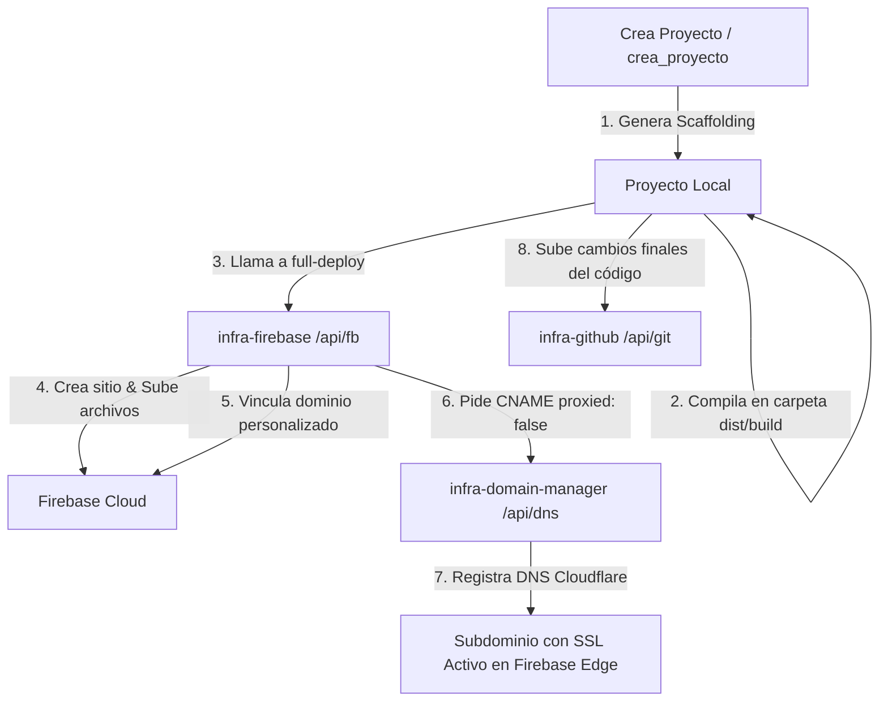

*   **Ruta de Configuración**: `IA_Configuracion/skills/gestiona_fierbase/SKILL.md`

---

# Skill: Gestiona Fierbase (`gestiona_fierbase`)

Este skill interactúa con el microservicio local **infra-firebase** (corriendo en el puerto **3200** o de manera centralizada a través del API Gateway en `http://localhost:3000/api/fb`) para configurar credenciales, gestionar la base de datos Firestore, controlar Firebase Auth y desplegar en Firebase Hosting de manera programática a través de una interfaz REST.

**Importante**: Todas las operaciones de Firebase se deben realizar a través de este microservicio (`infra-firebase`) en lugar de llamar directamente a la CLI local de `firebase` por comandos del sistema.

---

## Cuándo activar

Activa esta habilidad cuando se solicite:
- *"inicializa firebase / fierbase para el proyecto..."*
- *"añade Firestore para guardar datos..."*, *"crea un documento en la colección..."*
- *"busca leads en Firestore"*, *"consulta usuarios..."*
- *"registra un nuevo usuario"*, *"crea usuario en Firebase Auth"*
- *"despliega la carpeta build/dist en Firebase Hosting"*
- *"ejecuta un despliegue y guarda logs"*

---

## Instrucciones de Uso y Automatización

### Paso 1: Verificar el Estado del Servidor (Health Check)

El servidor corre por defecto en el puerto **3200** (mapeado a través del Gateway central en `/api/fb`). Comprueba si está activo a través del Gateway:

```powershell
try { $r = Invoke-RestMethod -Uri "http://localhost:3000/api/fb/ping" -TimeoutSec 3; $r.status } catch { "OFFLINE" }
```

Si no está activo, inicialízalo usando la skill `gestiona_infraestructura` o arráncalo de forma individual:
```powershell
Start-Process -FilePath "node" -ArgumentList "server.js" -WorkingDirectory "C:\Users\jjtei\Desktop\IA_Infraestructura\infra-firebase" -WindowStyle Hidden
Start-Sleep -Seconds 2
```

---

### Paso 2: Configurar Credenciales e Inicialización (`POST /api/config`)

Antes de realizar operaciones con Firebase, debes inyectar la configuración del proyecto o Service Account a través del microservicio:

```powershell
# Comprobar la configuración actual
$config = Invoke-RestMethod -Uri "http://localhost:3000/api/fb/api/config"
$config | Format-List

# Registrar configuración (Token de Firebase o Service Account)
$body = @{
    projectId = "tu-proyecto-firebase"
    # Opción A: Usar Token CI
    firebaseToken = "1//0xxxxxxxxx..."
    # Opción B: Usar Service Account
    serviceAccountKeyPath = "C:\Users\jjtei\Desktop\credenciales-firebase.json"
} | ConvertTo-Json

$res = Invoke-RestMethod -Uri "http://localhost:3000/api/fb/api/config" -Method Post -Body $body -ContentType "application/json"
$res | Format-List
```

*Nota: El microservicio intentará leer de forma automática un archivo `serviceAccountKey.json` en su raíz o las variables de entorno del sistema si no se le especifican estos campos.*

---

### Paso 3: Operaciones con Firestore (Base de Datos)

#### A. Crear o Actualizar un Documento
Permite guardar datos en una colección. Si el ID no se provee, Firestore generará uno automáticamente.
```powershell
$body = @{
    collection = "leads"
    id = "lead_001" # Opcional
    data = @{
        nombre = "Joel Juana"
        email = "joel@example.com"
        fecha = (Get-Date -Format "yyyy-MM-dd HH:mm:ss")
    }
    merge = $true
} | ConvertTo-Json

$res = Invoke-RestMethod -Uri "http://localhost:3000/api/fb/api/firestore/document" -Method Post -Body $body -ContentType "application/json"
$res | Format-List
```

#### B. Obtener y Borrar Documento
```powershell
# Obtener un lead específico
$doc = Invoke-RestMethod -Uri "http://localhost:3000/api/fb/api/firestore/document/leads/lead_001"
$doc.data | Format-List

# Eliminar el lead
Invoke-RestMethod -Uri "http://localhost:3000/api/fb/api/firestore/document/leads/lead_001" -Method Delete
```

#### C. Realizar Consultas Filtradas (Query)
Puedes enviar un array de filtros (`field`, `operator`, `value`):
```powershell
$body = @{
    collection = "leads"
    filters = @(
        @{ field = "email"; operator = "=="; value = "joel@example.com" }
    )
    limit = 10
} | ConvertTo-Json

$res = Invoke-RestMethod -Uri "http://localhost:3000/api/fb/api/firestore/query" -Method Post -Body $body -ContentType "application/json"
$res.results | Format-Table
```

---

### Paso 4: Operaciones de Autenticación (Firebase Auth)

#### A. Registrar un Usuario Nuevo
```powershell
$body = @{
    email = "usuario@proyectos.com"
    password = "SuperPassword123"
    displayName = "Desarrollador IA"
} | ConvertTo-Json

$res = Invoke-RestMethod -Uri "http://localhost:3000/api/fb/api/auth/user" -Method Post -Body $body -ContentType "application/json"
$res | Format-List
```

#### B. Listar y Eliminar Usuarios
```powershell
# Listar hasta 50 usuarios registrados
$list = Invoke-RestMethod -Uri "http://localhost:3000/api/fb/api/auth/users?maxResults=50"
$list.users | Format-Table

# Eliminar un usuario por su UID
$uid = "xxxx-uid-generado-xxxx"
Invoke-RestMethod -Uri "http://localhost:3000/api/fb/api/auth/user/$uid" -Method Delete
```

---

### Paso 5: Despliegue de Hosting

#### A. Despliegue Simple (`POST /api/hosting/deploy`)

Para publicar un proyecto en Firebase Hosting de forma desatendida, compila tu proyecto localmente (`npm run build` o equivalente) y envía la ruta física de la carpeta compilada al microservicio:

```powershell
$body = @{
    folderPath = "C:\Users\jjtei\Desktop\Proyectos_IA\mi-proyecto-web\dist"
    projectId = "tu-proyecto-firebase" # Opcional si ya se configuró
} | ConvertTo-Json

$res = Invoke-RestMethod -Uri "http://localhost:3000/api/fb/api/hosting/deploy" -Method Post -Body $body -ContentType "application/json"
$res | Format-List
# El resultado incluirá el 'deployUrl' (ej. https://tu-proyecto.web.app)
```

#### B. Despliegue Completo con Automatización de Dominio (`POST /api/hosting/full-deploy`) [RECOMENDADO]

Crea el sitio en Firebase Hosting (si no existe), sube los archivos estáticos, vincula el dominio personalizado en Firebase y genera el CNAME en Cloudflare con proxy desactivado (`proxied: false`) en un solo paso atómico:

```powershell
$body = @{
    folderPath = "C:\Users\jjtei\Desktop\Proyectos_IA\mi-proyecto-web\dist"
    siteId = "mi-proyecto"                   # Nombre del sitio en Firebase
    customSubdomain = "mi-proyecto"          # Nombre del subdominio (ej: mi-proyecto.gironacc.com)
    projectId = "protocolo-farmacia"         # Opcional si ya se configuró
} | ConvertTo-Json

$res = Invoke-RestMethod -Uri "http://localhost:3000/api/fb/api/hosting/full-deploy" -Method Post -Body $body -ContentType "application/json"
$res | Format-List
```

#### C. Crear Sitio Multisitio (`POST /api/hosting/sites/create`)

Permite crear dinámicamente un sitio secundario de hosting en tu cuenta Firebase:

```powershell
$body = @{
    siteId = "nuevo-sitio-secundario"
} | ConvertTo-Json

Invoke-RestMethod -Uri "http://localhost:3000/api/fb/api/hosting/sites/create" -Method Post -Body $body -ContentType "application/json"
```

#### D. Vincular Dominio Personalizado (`POST /api/hosting/customDomains`)

Asocia un dominio al sitio de Firebase Hosting:

```powershell
$body = @{
    siteId = "nuevo-sitio-secundario"
    customDomain = "subdominio.gironacc.com"
} | ConvertTo-Json

Invoke-RestMethod -Uri "http://localhost:3000/api/fb/api/hosting/customDomains" -Method Post -Body $body -ContentType "application/json"
```

---

### Paso 6: Orquestación Secuencial (Workflow)

El microservicio permite enviar una lista de pasos en un único batch mediante `/api/workflow` para agilizar operaciones complejas:

```powershell
$body = @{
    steps = @(
        @{
            action = "firestore.set"
            collection = "auditoria"
            id = "ultimo_despliegue"
            data = @{ estado = "iniciado"; autor = "IA Agent" }
        },
        @{
            action = "hosting.deploy"
            folderPath = "C:\Users\jjtei\Desktop\Proyectos_IA\mi-proyecto-web\dist"
        }
    )
} | ConvertTo-Json

$res = Invoke-RestMethod -Uri "http://localhost:3000/api/fb/api/workflow" -Method Post -Body $body -ContentType "application/json"
$res.results
```

---

### Paso 7: Apagar el Servidor (Liberar Recursos)

Cuando finalicen todas las tareas de la base de datos o el despliegue, apaga el microservicio a través del Gateway:

```powershell
Invoke-RestMethod -Uri "http://localhost:3000/api/fb/api/shutdown" -Method Post
```

---

## Orquestación e Integración de Flujos

El flujo de despliegue integrado con subdominios y repositorio remoto es el siguiente:



### Protocolo de Coordinación:
1. **Inicialización**: El agente de `crea_proyecto` genera la estructura base.
2. **Construcción**: El agente ejecuta `npm run build` en el directorio local del proyecto.
3. **Despliegue y Dominios**: Se utiliza `gestiona_fierbase` (a través de `/api/fb/api/hosting/full-deploy`) para desplegar, asociar el dominio a Firebase y registrar el CNAME en Cloudflare con `proxied: false`.
4. **Versiones**: Se guarda el código final y su configuración con `gestiona_github` (`/api/git/posts` o `/api/git/workflow`).
