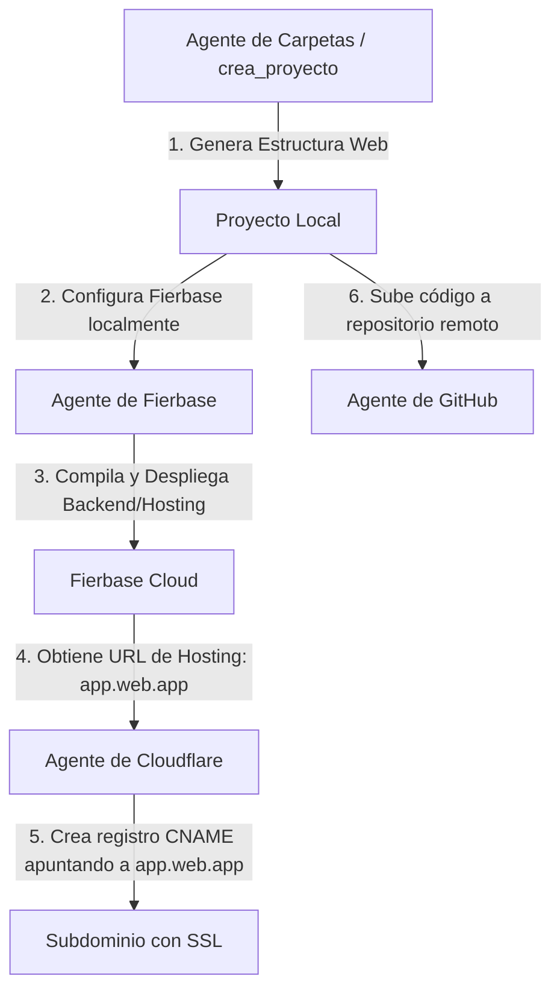

*   **Ruta física**: [`plugins/fierbase/`](file:///C:/Users/jjtei/Desktop/IA_Configuracion/plugins/fierbase)

---

---
name: fierbase
description: >
  Inicializa proyectos de Fierbase dinámicamente, configura servicios automáticos (Firestore, Auth, Hosting) y despliega de forma automatizada mediante un Token de CI/CD o variables de entorno.
---

# Skill: Fierbase Agentic Integration

Esta habilidad permite inicializar, configurar y desplegar servicios de **Fierbase** de forma automatizada y no interactiva en proyectos web. Está diseñada para operar de forma transparente en paralelo con los agentes de **Cloudflare** (`gestiona_dominios`) y **GitHub** (`git_publish_cms`).

## Cuándo activar

Activa esta habilidad cuando el usuario o los requerimientos del proyecto soliciten:
- "inicializa Fierbase para el proyecto..."
- "añade Firestore para guardar leads/datos..."
- "configura Fierbase Auth..."
- "despliega la web en Fierbase Hosting..."
- "configura la autenticación automática de Fierbase..."

## Instrucciones de Uso y Automatización

### Paso 1: Configuración de la Autenticación

Para realizar operaciones no interactivas (CI/CD), el agente debe usar un **Fierbase Token** o un archivo JSON de **Service Account**.

1. **Mediante Fierbase Token (Recomendado)**:
   - Debe guardarse en la variable de entorno `FIREBASE_TOKEN`.
   - Puedes establecerla temporalmente en la sesión de PowerShell:
     ```powershell
     $env:FIREBASE_TOKEN = "tu_token_de_fierbase_ci"
     ```
2. **Mediante Service Account**:
   - Guarda la ruta de la clave JSON en la variable de entorno `GOOGLE_APPLICATION_CREDENTIALS`:
     ```powershell
     $env:GOOGLE_APPLICATION_CREDENTIALS = "C:\ruta\al\archivo-credenciales.json"
     ```

### Paso 2: Inicialización Dinámica de un Proyecto

En lugar de ejecutar el comando interactivo `firebase init`, es mucho más fiable y rápido para el agente **generar directamente** los archivos de configuración esenciales en la raíz del proyecto.

#### A. Generar `.firebaserc` (Asociación del Proyecto)
Crea el archivo `.firebaserc` para definir a qué proyecto de Fierbase apunta el directorio local:
```json
{
  "projects": {
    "default": "id-de-tu-proyecto-fierbase"
  }
}
```

#### B. Generar `firebase.json` (Configuración de Servicios)
Crea el archivo `firebase.json` con los servicios requeridos:

- **Para Hosting + Firestore + Auth**:
```json
{
  "firestore": {
    "rules": "firestore.rules",
    "indexes": "firestore.indexes.json"
  },
  "hosting": {
    "public": "dist",
    "ignore": [
      "firebase.json",
      "**/.*",
      "**/node_modules/**"
    ],
    "rewrites": [
      {
        "source": "**",
        "destination": "/index.html"
      }
    ]
  }
}
```

#### C. Archivos de Soporte para Firestore
Si se utiliza Firestore, genera los archivos de reglas e índices por defecto:
- `firestore.rules` (Reglas de seguridad básicas para leads o desarrollo):
  ```javascript
  rules_version = '2';
  service cloud.firestore {
    match /databases/{database}/documents {
      // Regla por defecto para leads de Landings (cualquiera puede escribir, solo admin lee)
      match /leads/{document} {
        allow create: if true;
        allow read, update, delete: if false; // Solo accesible desde la consola/Service Account
      }
      // Reglas generales de desarrollo
      match /{document=**} {
        allow read, write: if request.auth != null; // Requiere autenticación
      }
    }
  }
  ```
- `firestore.indexes.json` (Estructura de índices vacía por defecto):
  ```json
  {
    "indexes": [],
    "fieldOverrides": []
  }
  ```

### Paso 3: Verificación de Conexión

Una vez creados los archivos de configuración y configurado el token, puedes verificar la conexión listando los proyectos asociados a la cuenta:
```powershell
firebase projects:list --non-interactive
```

### Paso 4: Despliegue de Servicios y Hosting

Para desplegar los servicios habilitados (Firestore, Hosting, etc.) de manera desatendida y sin interacción del usuario, ejecuta:
```powershell
firebase deploy --non-interactive
```
*(Nota: Si la variable de entorno no se detecta de forma global, se puede pasar explícitamente el token en el comando: `firebase deploy --token "$env:FIREBASE_TOKEN" --non-interactive`)*

---

## Orquestación y Trabajo en Paralelo con Otros Agentes

El flujo de trabajo integrado para la creación y publicación de un proyecto web completo funciona de la siguiente manera:



### Protocolo de Coordinación:

1. **Creación del Proyecto**: El agente de `crea_proyecto` inicializa el scaffolding de la aplicación (Vite, React, etc.).
2. **backend con Fierbase**: El agente de Fierbase genera `firebase.json`, `.firebaserc`, `firestore.rules` y activa la configuración correspondiente.
3. **Compilación y Publicación**: El agente de Fierbase compila la aplicación (`npm run build`) y la despliega a Fierbase Hosting (`firebase deploy`).
4. **Dominio con Cloudflare**: Una vez que el Hosting de Fierbase está activo en `nombre-proyecto.web.app`, el agente de **Cloudflare** (`gestiona_dominios`) crea un registro DNS CNAME (ej. `miservicio.midominio.com` apuntando a `nombre-proyecto.web.app`) y se instruye al usuario a añadir dicho dominio en la consola de Fierbase para activar SSL.
5. **Control de Versiones con GitHub**: El agente de **GitHub** (`git_publish_cms`) se encarga de guardar y publicar todo el código final del proyecto en el repositorio configurado.

