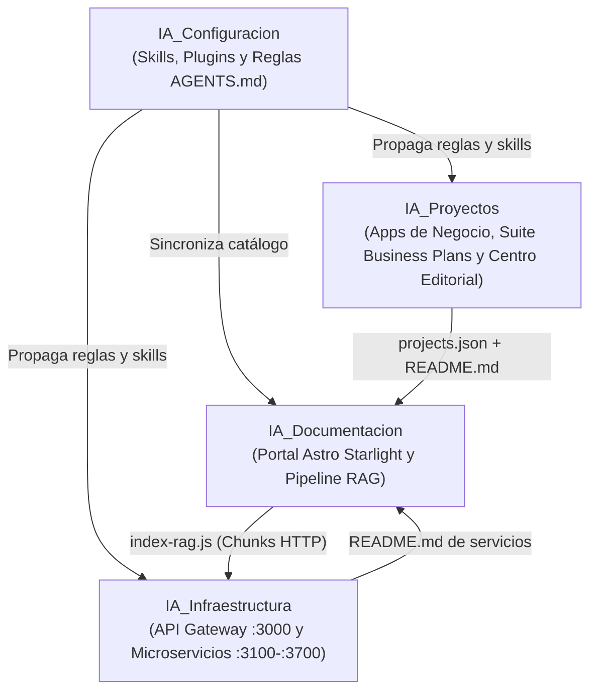

Este documento explica las decisiones arquitectónicas que sustentan el ecosistema local de agentes, cómo interactúan sus cuatro espacios de trabajo y cómo funciona el ciclo de memoria semántica (**RAG**).

---

## 1. Topología de Cuatro Pilares

Para evitar un único repositorio monolítico difícil de versionar y permitir que la configuración de los agentes evolucione de forma desacoplada del código de negocio, el ecosistema se divide en **4 repositorios especializados**:

1.  **`IA_Configuracion` (Gobernanza)**: Fuente única de la verdad para las habilidades (`skills/`), plugins (`plugins/`) y directrices (`AGENTS.md` globales y por proyecto).
2.  **`IA_Infraestructura` (Plano de Control Local)**: Expone capacidades del sistema (Git, Firebase, Cloudflare DNS, RAG, Scraping, Diseño) a través de una interfaz HTTP unificada en `http://localhost:3000`.
3.  **`IA_Proyectos` (Plano de Negocio)**: Monorepositorio que aloja las aplicaciones finales de usuario, simuladores financieros (`apps/business-plans/`) y el motor de maquetación (`docs/editorial/`).
4.  **`IA_Documentacion` (Memoria Viva)**: Agrega dinámicamente los metadatos y `README.md` de los otros tres pilares, construye el portal web bajo el estándar **Diátaxis** y alimenta la base vectorial del RAG.

---

## 2. Pipeline de Documentación Viva e Indexación Híbrida RAG

En lugar de mantener documentación manual desconectada del código, cada ejecución de `npm run build` en `IA_Documentacion/src/docs` dispara una tubería automatizada en tres etapas:

### Etapa 1: Sincronización Cruzada y Auto-Descubrimiento (`sync-catalog.js`)
*   Escanea físicamente `IA_Proyectos/apps/` y `apps/business-plans/` para auto-registrar cualquier proyecto nuevo en `projects.json`, y extrae tanto el `README.md` como el `CHANGELOG.md` individual de cada aplicación y simulador financiero.
*   Lee dinámicamente `IA_Proyectos/docs/editorial/catalog.js` para proyectar en vivo todas las publicaciones A4 y exportaciones Word del Centro Editorial.
*   Reconcilia de forma **bidireccional** `IA_Configuracion/skills/` y `~/.gemini/config/skills/`, y propaga `AGENTS.md`, plugins y reglas específicas `.agents/AGENTS.md` a los cuatro repositorios.
*   Purga cualquier ficha `.md` obsoleta y protege las estadísticas de portada cuando se ejecuta en entornos CI aislados.

### Etapa 2: Orquestación "Zero-Touch" (`auto-publish.js` / `npm run publish:auto`)
*   Ejecuta la sincronización y comprueba mediante `git status` si existen cambios documentales reales (omitiendo reconstrucciones redundantes cuando el portal ya está al día).
*   Valida los documentos con `audit-portal.js`, compila HTML estático + **Pagefind** + `sitemap.xml`, gestiona el encendido y apagado **JIT** del Gateway local si estaba en reposo para garantizar la indexación RAG incremental (`SHA-256`), despliega en Firebase Hosting (`documentacion-ia`) y versiona en GitHub.

### Etapa 3: Fragmentación Híbrida e Ingesta RAG (`index-rag.js`)
*   Recorre todos los documentos de `src/content/docs/`.
*   Aplica **chunking híbrido**: divide primero por encabezados semánticos (`##` y `###`) y luego por ventana deslizante (`1000` caracteres máximos con `150` caracteres de solapamiento) para preservar el contexto.
*   Envía cada fragmento con sus metadatos (`source`, `file`, `url`, `section`, `chunk_index`) al microservicio `api-conocimiento-rag` a través del Gateway (`POST http://localhost:3000/api/rag/index`).

---

## 3. Optimización para Arquitectura Windows ARM64 (Snapdragon X Elite)

La estación de trabajo principal opera sobre un procesador **Qualcomm Snapdragon X Elite (Windows ARM64)** con 32 GB de RAM. Esta arquitectura ofrece una eficiencia energética y rendimiento multi-hilo sobresalientes cuando el software se ejecuta de forma nativa, pero penaliza los binarios compilados para `x64` que requieren traducción dinámica mediante el emulador **Prism**.

Por ello, el diseño del ecosistema aplica tres principios de ingeniería:
1.  **Binarios Nativos ARM64**: Node.js, Git, Python y dependencias con bindings nativos (como `sharp` o `esbuild`) se instalan estrictamente en sus variantes nativas `win32-arm64`.
2.  **Ciclo de Vida Bajo Demanda**: Los microservicios de `IA_Infraestructura` (puertos `3000–3799`) se levantan bajo demanda al iniciar tareas que los requieren y se apagan limpiamente (`npm run stop`) al concluir, manteniendo el consumo en reposo en cero.
3.  **Compilación Granular**: En monorepositorios con múltiples aplicaciones (`IA_Proyectos`), únicamente se compila y despliega el subproyecto modificado, evitando reconstrucciones masivas innecesarias.
