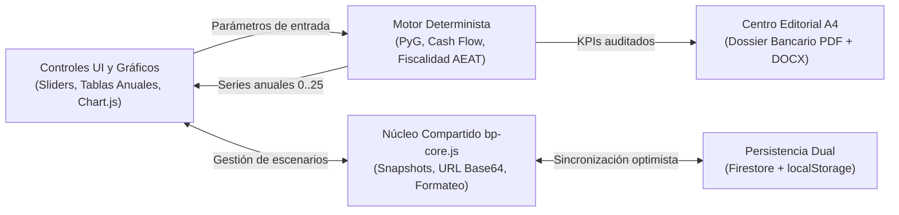

La **Suite Business Plans** y el **Centro Editorial A4** conforman un sistema dual diseñado para resolver un problema habitual en consultoría financiera e inversión patrimonial: la divergencia entre los modelos dinámicos de simulación y los informes ejecutivos entregados a entidades bancarias o socios inversores.

Este documento explica las decisiones de arquitectura que garantizan consistencia matemática, resiliencia offline y trazabilidad documental en todo el ecosistema.

---

## 1. Arquitectura Desacoplada: Estado, Cálculo Puro y Persistencia

En lugar de acoplar las fórmulas financieras a componentes de interfaz complejos, cada simulador (`app-bp-*`) divide su arquitectura en tres capas independientes coordinadas por [`gestiona_business_plan`](/agente/skills/gestiona_business_plan/):

### Ventajas de este diseño
*   **Determinismo contable**: El motor financiero opera mediante funciones puras sin efectos secundarios. Dado un mismo vector de hipótesis iniciales, produce exactamente la misma serie temporal (años `0..25`) tanto en el navegador como en scripts de verificación.
*   **Latencia cero en interacción**: Al mover un control deslizante, el recálculo ocurre íntegramente en memoria en menos de `2 ms`, mientras que `bp-core.js` aplica *debouncing* antes de persistir en `Firestore` para no saturar la red.
*   **Portabilidad sin servidor**: La serialización compacta en URL (`?s=base64`) permite compartir un escenario completo con un tercero mediante un enlace inmutable sin requerir permisos de lectura en base de datos.

---

## 2. Separación Estricta entre Cuenta de Resultados (PyG) y Tesorería (Cash Flow)

Uno de los errores más frecuentes en simuladores improvisados consiste en mezclar partidas contables de devengo con movimientos reales de caja. Todos los modelos de la suite imponen por diseño cuatro invariantes financieros documentados en el [Estándar Financiero y Editorial A4](/referencia/estandar-financiero-y-editorial/):

1.  **Amortización técnica y escudos fiscales vs. Amortización de deuda**:
    *   La depreciación contable del inmovilizado (o la deducción anual del `7,5%` del fondo de comercio en oficinas de farmacia) reduce la base imponible en **PyG** generando ahorro fiscal real, pero **no supone salida de caja**.
    *   Por el contrario, la devolución del principal de un préstamo hipotecario **no es gasto deducible en PyG**, pero sí constituye una salida directa en el **Flujo de Caja Financiero**.
2.  **CAPEX Total frente a Base Financiable (LTV)**:
    *   Los tributos de adquisición (ITP, AJD, IVA no recuperable), aranceles notariales y registrales forman parte del desembolso inicial que debe cubrirse con fondos propios, excluyéndose sistemáticamente de la base sobre la que el banco aplica el porcentaje de *Loan-to-Value* (`LTV`).
3.  **Dimensionamiento de Póliza de Crédito en Horizonte Completo (`0..N`)**:
    *   Evaluar las necesidades de circulante únicamente en el arranque ignora valles de liquidez futuros provocados por reposiciones de equipamiento (*CAPEX de mantenimiento*) o saltos fiscales cuando se agotan las Bases Imponibles Negativas (*BINs*). Por ello, el límite recomendado de póliza inspecciona toda la curva acumulada `0..25`.

---

## 3. Convergencia con el Centro Editorial A4

Cuando una operación supera la fase exploratoria en el simulador interactivo y requiere presentación formal ante un comité de riesgos bancario, entra en juego [`centro-editorial`](/proyectos-ia/apps/centro-editorial/) mediante el preset `dossier_financiero`:

*   **Fuente única de métricas**: Los KPIs de cabecera (TIR, VAN, Payback, DSCR mínimo y fondos propios requeridos) que se maquetan en `IA_Proyectos/docs/editorial/Finanzas_y_Dossiers/` provienen exactamente del escenario base auditado en el simulador correspondiente.
*   **Doble entregable nativo**: El motor editorial genera simultáneamente un **PDF vectorial A4** (listo para firma o envío) y un documento **Word (`.docx`)** editable para equipos jurídicos o fiscales, incrustando el PDF resultante en `public/docs/` dentro del propio simulador web para descarga directa desde su cabecera.
