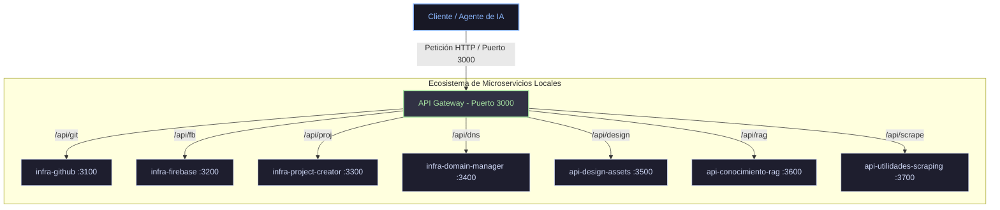

Toda la automatización local de la suite de agentes se apoya en un ecosistema de microservicios locales coordinados que corren de forma nativa en la máquina.

---

## Mapa de Red Local

Para simplificar la comunicación, todas las llamadas se centralizan a través de un **API Gateway** unificado en el puerto **3000**. Este actúa como proxy reverso, redirigiendo el tráfico hacia los puertos internos dedicados de cada microservicio:

---

## Matriz de Puertos y Servicios Reservados

Los puertos del **3000 al 3799** están estrictamente reservados para los servicios locales. Nunca se deben usar estos puertos para servidores de desarrollo de apps de negocio.

| Servicio | Puerto Interno | Ruta Gateway | Requiere `.env` | Descripción |
| :--- | :---: | :--- | :---: | :--- |
| **infra-gateway** | `3000` | `/` | No | Gateway central, health check y Dashboard web interactivo. |
| **infra-github** | `3100` | `/api/git/*` | **SÍ** | Automatización Git y sincronización de repositorios remotos. |
| **infra-firebase** | `3200` | `/api/fb/*` | **SÍ** | API REST local de Firebase (CRUD Firestore y hosting). |
| **infra-project-creator** | `3300` | `/api/proj/*` | No | Asistente de creación e inicialización de nuevos proyectos. |
| **infra-domain-manager** | `3400` | `/api/dns/*` | **SÍ** | Validación DNS y registros CNAME vía Cloudflare API. |
| **api-design-assets** | `3500` | `/api/design/*` | No | Inyección de paletas, fuentes Google y mockups CSS. |
| **api-conocimiento-rag** | `3600` | `/api/rag/*` | **SÍ** | Almacenamiento vectorial y búsqueda semántica de documentos. |
| **api-utilidades-scraping**| `3700` | `/api/scrape/*`| No | Extractor limpio de páginas web a Markdown. |

---

## Configuración y Variables de Entorno

Los microservicios que requieren variables de entorno deben tener configurado su archivo `.env` en su respectivo directorio dentro de `IA_Infraestructura`:

*   **infra-github**: Requiere `GITHUB_TOKEN` para la API de GitHub y definición de propietario/repositorio.
*   **infra-domain-manager**: Requiere tokens de Cloudflare (`CLOUDFLARE_API_TOKEN`) y zona del dominio base.
*   **infra-firebase**: Requiere el archivo JSON de credenciales de servicio de la cuenta de Firebase.
*   **api-conocimiento-rag**: Almacena de forma autónoma su base de datos local en `data/store.json`.
