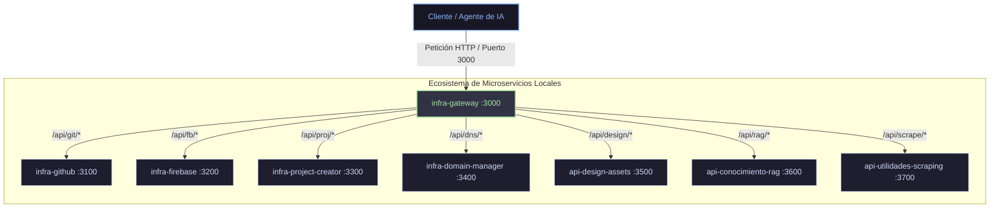

El proyecto **IA_Infraestructura** es un monorepositorio local diseñado para orquestar la suite de microservicios de desarrollo y soporte del ecosistema de agentes. Cuenta con un **API Gateway** centralizador, runner multiplataforma, panel web interactivo de observabilidad y soporte para orquestación mediante **PM2**.

*   **Ubicación física**: [`IA_Infraestructura/`](file:///c:/Users/jjtei/Desktop/IA_Infraestructura)
*   **Gestión de Procesos**: PM2 o runner standalone en background.
*   **Puerto unificado**: `3000` (coordinado por el Gateway).

---

## 🗺️ Arquitectura de Red y API Gateway

Toda la comunicación de los agentes de IA y las aplicaciones clientes se realiza a través de un **API Gateway** centralizador en el puerto **3000** (`infra-gateway`). Este actúa como proxy reverso, redirigiendo el tráfico a los puertos internos dedicados de cada microservicio:

---

## 🚀 Modos de Ejecución y Arranque

Los servicios pueden gestionarse en dos modalidades desde la raíz de `IA_Infraestructura`:

### 1. Modo Standalone (Runner síncrono/asíncrono)
Utiliza un runner en Node.js desarrollado a medida que levanta y detiene los subprocesos de forma nativa en segundo plano:
*   **Arrancar todo**: `npm run start` (levanta todos los microservicios en background).
*   **Detener todo**: `npm run stop` (envía señales `/api/shutdown` de apagado controlado a cada servicio).
*   **Verificar salud**: `npm run status` (comprobador de puertos de red) o `npm run health` (test de salud HTTP).

### 2. Modo PM2 (Ejecución persistente)
Para un entorno robusto de ejecución persistente con autoreinicio ante fallos, se dispone de una configuración de PM2 (`ecosystem.config.cjs`):
*   **Arrancar suite**: `npm run pm2:start` (lanza PM2).
*   **Detener suite**: `npm run pm2:stop`.
*   **Estado de procesos**: `npm run pm2:status` (ejecuta `pm2 list`).
*   **Visor de logs**: `npm run pm2:logs`.

---

## 💻 Panel de Control de Observabilidad (Dashboard)

Al iniciar la suite (`npm run start`), puedes acceder directamente a la interfaz web de observabilidad desde tu navegador en:
👉 **[http://localhost:3000](http://localhost:3000)**

El dashboard permite:
1.  **Monitorizar Salud**: Visualizar en tiempo real el estado (`saludable`/`degradado`/`desconectado`) de cada microservicio.
2.  **Verificar Entorno**: Badges interactivos que alertan de archivos `.env` faltantes o configuraciones erróneas.
3.  **Logs en Vivo**: Consola integrada para revisar las últimas 250 líneas de salida estándar (stdout/stderr) de cada proceso.
4.  **Control Manual**: Botones gráficos para arrancar y detener servicios de forma individualizada.
